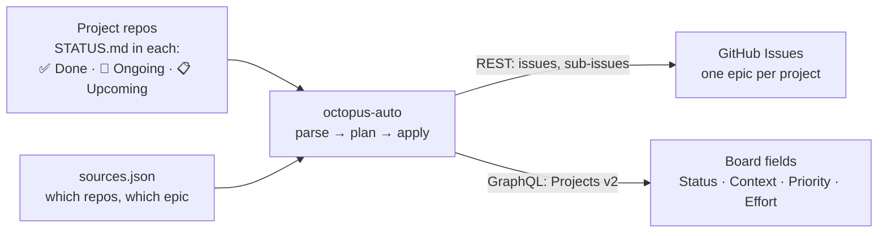

# octopus-auto

**Claude Code runs my GitHub task board.** It reads the status docs in my project repos and keeps a GitHub Projects v2 board in step with them: it creates tickets, moves them through Backlog → Todo → In Progress → Done, and closes them. I review what it changed instead of maintaining a tracker by hand.

**[See the live demo board →](https://github.com/users/Yogesh-GIT99/projects/5)** (generated from the [example projects](examples/))

*By Yogesh Rautela · [LinkedIn](https://www.linkedin.com/in/yogesh-rautela-895655221) · [GitHub](https://github.com/Yogesh-GIT99)*

---

## Why

I work on several infrastructure projects in parallel. The truth about each one lives in the repo, next to the code: a short status doc engineers already update as they work. Copying that into a tracker by hand is slow, and the tracker goes stale within days.

So the board is **derived** from the repos instead of being maintained separately.

## In daily use

I've run this on my real work since July 2026. That board is private because it covers client infrastructure; this repo is the cleaned-up, reusable version.

| | |
|---|---|
| Board items managed | **160**, of which **82 Done** |
| Issues created and kept current | **178**, as epics with sub-issues |
| Source repos | **4 active**, across 3 contexts (two client workstreams and learning) |
| Day-to-day effort | I say *"ticket sync"*; Claude applies the changes and reports back |

The work it tracks includes moving a web fleet to ARM servers with OpenTofu and Ansible, building an ECS Fargate deployment platform, SRE incident fixes and AWS cost work. All of it flows from those repos' status docs to the board without manual ticket writing.

## How it works



1. **Each project keeps a status doc** with three sections. One top-level bullet is one ticket, and its bold text is the title:
   ```markdown
   ## 🔄 Ongoing
   - **Production approval gate** — working on it; required reviewer on prod
   - **Cross-account DNS writer** — waiting for the DNS account owner
   ```
2. **Parse.** Bullets are mapped to a status. Done → Done, Upcoming → Backlog. Ongoing becomes In Progress, or Blocked when the text says "blocked on" or "waiting for", or Todo when it starts with "Next:".
3. **Plan.** This is a pure function that compares the doc with the epic's sub-issues and their board status. It decides what to create, move, close or reopen.
4. **Apply.** It writes to GitHub with the `gh` CLI, or prints the plan with `--dry-run`.

Here is a real run after moving one item to Done and adding one to Upcoming in [deploy-platform](examples/deploy-platform/STATUS.md):

```console
$ python3 -m octopus.sync --dry-run
== edge-fleet (epic #1): no changes
== deploy-platform (epic #2): 3 changes (dry run)
  ~   #19  Todo -> Done   [Platform] Image cleanup policy
  x   #19  close   [Platform] Image cleanup policy
  +   new  create [Backlog]   [Platform] Per-service task roles
== terraform-prep (epic #3): no changes
```

## Design decisions

- **The repo is the source of truth.** Status is written once, next to the code. The board is a view of it.
- **Re-running is safe.** Items are matched by normalised title, never by position. An unchanged doc produces zero writes, and an interrupted run can just be run again; this is tested.
- **Nothing is deleted.** If an item leaves the doc, its ticket is reported and left alone.
- **The agent's permissions are limited on purpose.** [CLAUDE.md](CLAUDE.md) says what Claude may do on its own (reads, new tickets, comments) and what needs my confirmation (changing existing tickets, closing, bulk edits, anything destructive), asked once per batch. The sync command is the one explicit exception that applies automatically.
- **Sources can be paused** with `"active": false`.
- **Lessons are written down.** Every API gotcha we hit became a fix plus a note in [docs/lessons.md](docs/lessons.md), so it doesn't happen twice.

## Try it

You need Python 3.10+ and the [GitHub CLI](https://cli.github.com/) logged in with the `project` scope (`gh auth refresh -s project`). There are no other dependencies.

```bash
python3 -m unittest discover -s tests -t .   # parser and planner tests
python3 -m octopus.sync --dry-run            # see what would change
python3 -m octopus.sync                      # apply
```

To point it at your own board, see [docs/SETUP.md](docs/SETUP.md).

## Repo layout

```
octopus/sync.py        parse → plan → apply (single file, standard library only)
tests/                 unit tests for parsing and planning
sources.json           which status docs feed which epic on which board
examples/              made-up projects that feed the demo board
CLAUDE.md              the agent's operating rules
docs/SYNC.md           the reconcile algorithm in detail
docs/SETUP.md          creating a board and wiring a new repo
docs/lessons.md        GitHub API gotchas found in real use
.claude/               example Claude Code settings for unattended runs
```

## Built with Claude Code

Claude Code is the operator: it runs the sync when I ask, writes and updates the status docs as we work, and keeps its own operating notes in persistent memory. The code in this repo was written with Claude Code as well.
